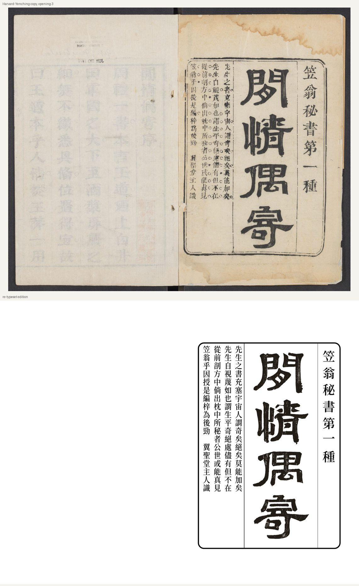
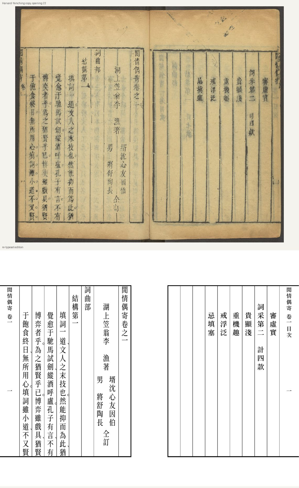
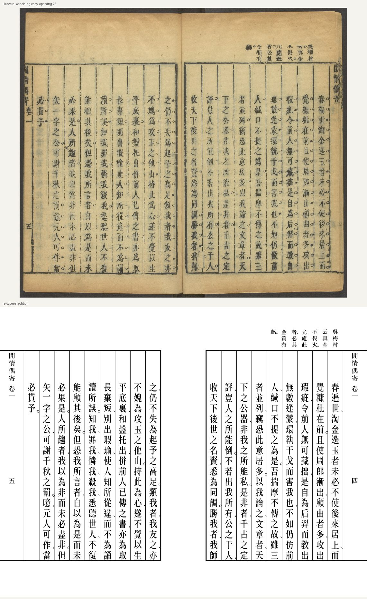

# 閒情偶寄（一）重排本

清李漁《閒情偶寄》十六卷，康熙間翼聖堂刻本第一冊（余懷序、凡例七則、總目、卷一目次、卷一詞曲部
結構第一・詞采第二）之**仿刻重排本**：直排，一頁當原刻半葉，行款、低格、抬頭、雙行小注、版心悉依原刻，
可與原書逐葉對檢。

A vertical re-typeset of volume 1 of Li Yu's *Xianqing ouji* (Kangxi woodblock edition), page for page
and column for column like the original, with a modern apparatus. Classical Chinese, no translation.

## 原刻與重排對照

上為哈佛燕京圖書館藏本（彩色掃描），下為本版同一開。

| 扉葉 | 卷一首葉 | 正文與眉批 |
|---|---|---|
|  |  |  |

## 全書重排進度

全書八部十六卷（據本書總目）。目前完成卷首與卷一，約全書十六分之一。

| 部 | 卷 | 內容 | 進度 |
|---|---|---|---|
| 卷首 | — | 余懷序、凡例七則、總目、卷一目次 | ✅ 錄文、兩校、哈佛本覆核、排版；圈點依原刻 |
| 詞曲部 | 一 | 結構第一、詞采第二 | ✅ 同上；圈點暫依維基文庫句讀；眉批存疑作「□」 |
| 詞曲部 | 二–三 | 音律第三、賓白第四、科諢第五、格局第六、填詞餘論 | ⬜ 未開始 |
| 演習部 | 四–五 | 選劇、變調、授曲、教白、脫套 | ⬜ 未開始 |
| 聲容部 | 六–七 | 選姿、修容、治服、習技 | ⬜ 未開始 |
| 居室部 | 八–九 | 房舍、窗欄、牆壁、聯匾、山石 | ⬜ 未開始；🖼 窗欄、聯匾插圖十九幅已製線稿 |
| 器玩部 | 十–十一 | 制度、位置 | ⬜ 未開始；🖼 暖椅式一幅已製線稿 |
| 飲饌部 | 十二 | 蔬食、穀食、肉食 | ⬜ 未開始 |
| 種植部 | 十三–十四 | 木本、藤本、草本、眾卉、竹木 | ⬜ 未開始 |
| 頤養部 | 十五–十六 | 行樂、止憂、調飲啜、節色慾、卻病、療病 | ⬜ 未開始 |

後續各冊之掃描均已可得：北大本 Internet Archive `02097226.cn`–`02097232.cn`（黑白），
哈佛本同一 IIIF 清單之第 2–8 冊（彩色，`tools/fetch_harvard.py`）。兩本分冊不同，按版心卷次葉次對應。

## 兩種 PDF（見 Releases）

- **對開閱讀本** `xianqing-ouji_juan01_spread.pdf`：一頁一開（右為前葉下半，左為後葉上半，版心在兩外側），
  如翻閱原書；任何閱讀器皆正確。
- **單頁本** `xianqing-ouji_juan01_single.pdf`：一頁一半葉，供列印與手機閱讀。

兩者皆有書籤，書末校記與正文雙向連結。檔名按卷：`juan01` 為卷首與卷一，以後依次為 `juan02`、`juan02-03`
之類（兩藏本分冊不同，故以卷不以冊）；Release 版本號另計（v0.1 …）。

## 底本與做法

- **底本**：北京大學圖書館藏本（Internet Archive [02097225.cn](https://archive.org/details/02097225.cn)，
  黑白掃描）。**參校**：哈佛燕京圖書館藏同版印本
  （[HOLLIS 990080074400203941](https://id.lib.harvard.edu/alma/990080074400203941/catalog)，彩色掃描）。
  兩本同出一副版片；裝訂次第、扉葉及前後空白葉從哈佛本。哈佛本缺十條眉批，為印次不同。
- **錄文**：逐葉逐行錄出（`text/v1/NNN.txt`，NNN 為北大本掃描號），經兩道校對，存疑處再以哈佛本覆核；
  過程記錄在 `work/notes/`（初錄）與 `work/review/`（校對、覆核）。
- **字形**：原刻異體統一為通行字（`text/variants.tsv`，書末附「異體字統一表」）；于／於、后／後、迺等照錄。
- **圈點**：序、凡例、總目依原刻錄入；卷一原刻圈點繁密而未及覆核，暫依維基文庫標點本斷句
  （`text/marks_wikisource.tsv`，句末小圈、句中頓點）。原刻圈點之錄文仍在 `text/v1/`。
- **眉批**：照北大本錄出，凡不能確定之字作「□」。
- **扉葉**據哈佛本重排，隸書書名取自哈佛本影像。
- **插圖**：全書二十幅插圖（居室部、器玩部，在後冊）已據哈佛本去透印、製成線稿，供日後各冊之用
  （`tools/make_plates.py`，清單見 `figures/README.md`）。

## 尚待完成，歡迎 PR

- 卷一原刻圈點（句讀圈、密圈、實心點）之校定；`tools/extract_marks.py` 可據哈佛本自動辨識作初稿。
- 眉批之「□」與存疑字：需另一印有眉批之藏本（如國家圖書館藏本）。
- 錄文、校記之任何錯誤。

改正錄文請直接改 `text/v1/NNN.txt`（格式見 `work/TRANSCRIPTION.md`），以
`python tools/check_page.py NNN` 生成原刻與重排之對照圖（`work/check/NNN.png`）核對，再提交 PR，
並在說明中註明依據（哪一本、第幾開）。

## 重建

需 TeX Live（XeLaTeX）、Python 3（Pillow、numpy、scipy、PyYAML、opencc、pypdf）、libtiff 之 `tiffcp`。

```
python tools/fetch_fonts.py          # Noto Serif TC、全字庫正楷體、正宋體 → fonts/
python tools/fetch_pku.py            # 北大本掃描 → scans/v1/（校對、對照用）
python tools/fetch_harvard.py 1 78   # 哈佛本第一冊 → scans/harvard/（覆核、扉葉、圈點辨識用）
python tools/fetch_wikisource.py     # 維基文庫本 → text/wikisource/
python tools/wiki_punct.py           # 卷一句讀層 → text/marks_wikisource.tsv（已在庫中）
python tools/gen_pages.py            # text/ → pages/（每半葉一個 TikZ 頁）
python tools/gen_appendix.py         # 編輯說明、異體字統一表、校記 → pages/appendix.tex
xelatex -output-directory=build main_spread   # 對開本（兩遍）
xelatex -output-directory=build main          # 單頁本（兩遍）
```

建書只需字體與 `text/`、`front/`、`figures/`；掃描僅供校對與重製圖像。

## 目錄

```
text/v1/NNN.txt        錄文，v1 = 北大本第一冊（IA 02097225.cn），NNN = 其掃描號；一行＝原刻一行
                       （圈點、密圈、割注、抬頭、眉批、版心之標記見 work/TRANSCRIPTION.md）
text/layout.yaml       版式（行數、格數、低格）、各頁版式與次第、書籤
text/variants.tsv      異體字 → 通行字
text/jiaoji.yaml       校記
text/marks_wikisource.tsv  卷一句讀層（據維基文庫）
front/                 書衣、書衣內面、扉葉、封底
figures/               書衣紙紋、扉葉書名；plates/ 插圖線稿（不入庫，可重製）
tools/                 生成、檢查、下載、圖像處理之腳本
work/                  錄文與校對規範、各道記錄
```

## 授權

- 原書文字、圖像：公有領域。哈佛圖書館對其公開之公有領域作品數字影像不主張著作權。
- 本版排版、編輯說明、校記、錄文標記：[CC BY 4.0](LICENSE)。
- 腳本：[MIT](tools/LICENSE)。
- 卷一句讀（`text/marks_wikisource.tsv` 及書中卷一之句讀）源自維基文庫《閑情偶寄》，依其授權為 CC BY-SA 4.0。
- 字型：Noto Serif TC（SIL OFL 1.1）；全字庫正楷體、正宋體（政府資料開放授權條款）。

## 致謝與說明

編者 metachow。錄文、校對、排版由 Claude（Anthropic）輔助完成，**尚未經通曉古籍者通校**，引用請核原書。
